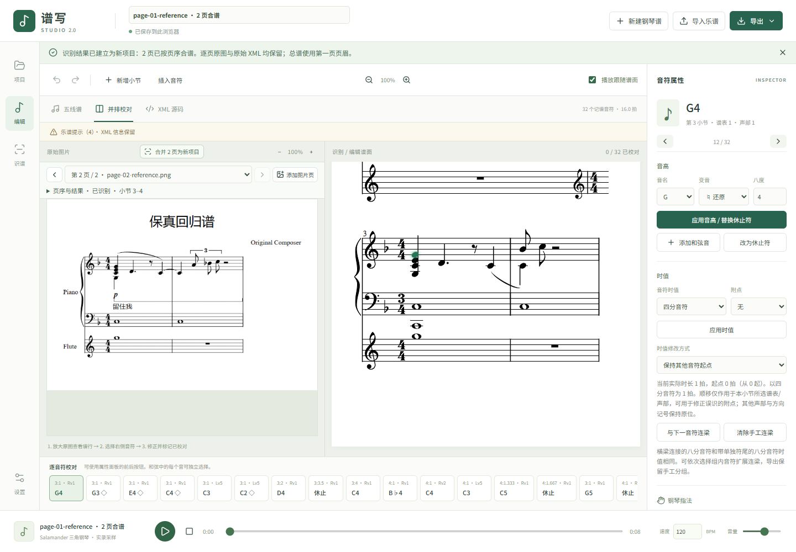
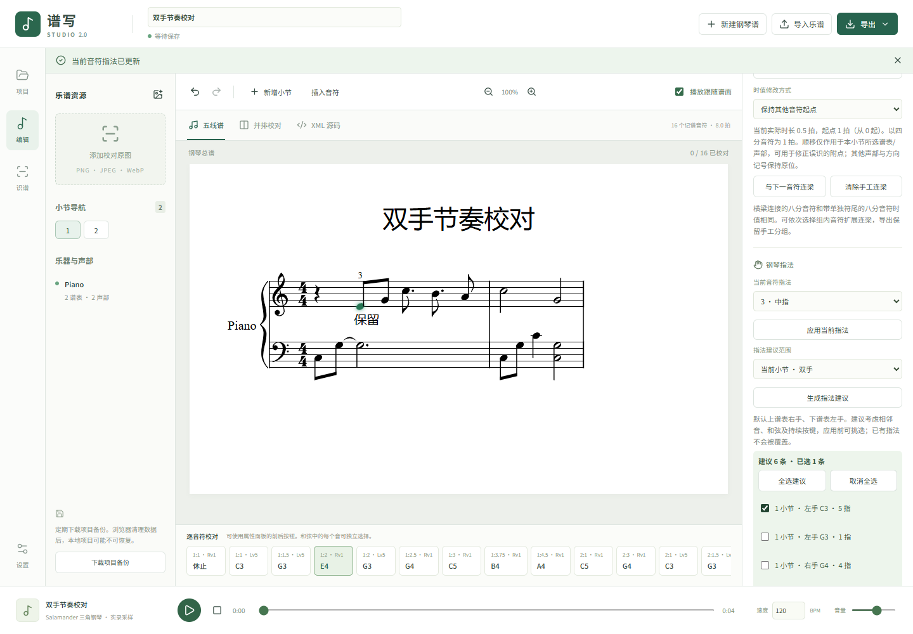

# 多页识谱、项目恢复与指法验收

日期：2026-11-05。沿用独立分支 `codex/studio-2-engineering`，在已验证的连梁、同步高亮与钢琴采样提交 `e6ed2bc` 上继续。原始 ZIP 和浏览器原项目均未覆盖。

## 交付行为

- 多选或拖入 PNG/JPEG/WebP，按数字文件名排序并可调序；最多 60 页，每页 25 MB / 4000 万像素，全部原图合计约 80 MB。PDF/TIFF/HEIC 请先逐页转图。
- [homr-web](https://github.com/jymen/homr-web) 的单页 API 在一个批次中复用 Worker 和模型。只做一次应用层模型预检，逐页存储完整结果，失败/取消不清除成功页，重试跳过已成功页。
- 合谱复制 MusicXML 小节 DOM，连续编号、页边界及小节索引；逐页原图、引擎原始 XML、识谱框、OCR 和错误元数据保留。总谱页眉来自第一页。出现不兼容乐器、谱表、重复 ID 或跨页属性导致的音高/时间变化时拒绝合谱，可单独打开/下载原始页。未重新推断跨页延音和节奏。
- 比对区可翻页定位，选择音符/跟随播放可切换原图页。长谱按小节/声部索引音头，播放只更新当前小节的高亮；逐音符条在比对区显示当前页，不随每个播放时钟更新全谱。
- 项目库删除到废纸篓，刷新后仍可恢复。IDB 的删除/恢复事务保留全部字段，并防止其他标签页的自动保存改变删除状态。没有彻底删除功能，废纸篓不释放空间。
- 通过“音符属性 → 钢琴指法”手动标注 1–5 指，或预览当前小节/整曲的双手建议并勾选应用。实际写入 MusicXML `notations/technical/fingering`，谱面可见，支持撤销；已有指法、其他技术记号及时间线保留。建议假定上右手、下左手，受手型/奏法影响，需由演奏者确认。

## 实际验证

| 检查                                              | 结果                                                              |
| ------------------------------------------------- | ----------------------------------------------------------------- |
| `npm run build`，包含 TypeScript 类型检查         | 通过；30/30 钢琴采样哈希通过                                      |
| `npm test`                                        | 83/83，通过，9 个测试文件                                         |
| 开发版 Chrome `npm run test:e2e`                  | 15/15，通过，35.7 秒                                              |
| 生产版 Chrome `E2E_PRODUCTION=1 npm run test:e2e` | 15/15，通过，30.0 秒                                              |
| 开发版真实两页 WASM 识谱                          | 46.935 秒；16 + 16 个音符，合谱 32 个                             |
| 生产版真实两页 WASM 识谱                          | 48.347 秒；16 + 16 个音符，合谱 32 个                             |
| 用户 214 音符校对副本的指法预览                   | 生产 Chrome 生成 210 条候选，无页面异常；未应用到原项目或副本文件 |

实际两页测试使用同一张程序生成的回归谱图作为两个有序输入，确实分别执行两次 WASM 推理，未替换模型或引擎输出。两套环境都只做 7 项 HEAD 模型预检，第二页选中第 3 小节，无页面异常。浏览器 E2E 还使用内容不同的两页固定 XML 夹具单独验证合并、顺序、逐页定位和不兼容结构保护。真实推理证明批次链路可用，不证明音乐识别准确性；原图仍需逐页校对。未做 60 页整批性能测试。

补充回归覆盖移动端多页选择、缺模型不生成谱、单页失败后只重试该页、取消忽略迟到结果、页数据往返、已删除项目跨刷新恢复、指法在 SVG 可见及仅应用勾选项、XML 撤销和保存后恢复。双手同时播放、和弦同步高亮、原始乐谱/MXL 往返均通过。

新增测试首轮曾因失败结果的 TypeScript 联合类型和单谱表夹具仍含第二谱表音符而失败；已修正后重跑。构建仍有既有 OpenCV 的 `fs/path/crypto` 外部化警告，实际 Worker/WASM 初始化与两页推理均通过。本轮没有修改 npm 依赖版本。

原始谱面的前 3 小节连梁与两处延音线校对另见 [钢琴播放验收](PIANO-PLAYBACK-VALIDATION.md)。第 5、6、7、10、11 小节的识谱超拍未猜测修正。项目副本与原始备份在 `D:/孙晋晶/codex/deliverables/`。

[开发推理记录](omr-multipage-dev.json) · [生产推理记录](omr-multipage-result.json) · [真实合谱 XML](omr-multipage.musicxml)

