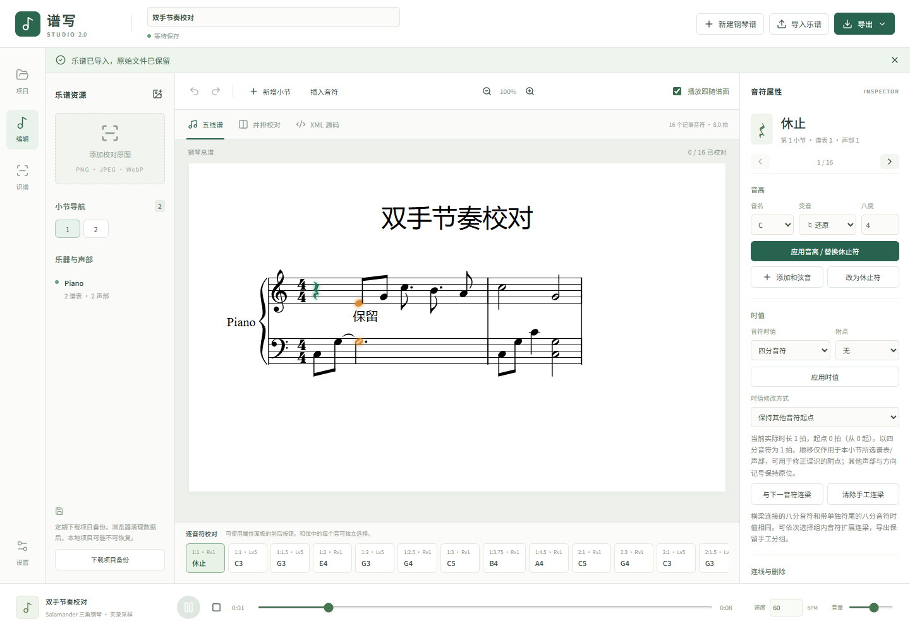

# 连梁、同步高亮与钢琴采样验收

日期：2026-11-05。工作目录 `D:/孙晋晶/codex/sheet-music-studio`。开始时 Git 干净；原始压缩包、已有项目和模型保持完整。

## 已实施

- 缺少 MusicXML beam 时自动连梁，仅作用于排版。提供手工连接/扩展/清除同声部连梁，包含十六分音符的次级梁与钩；不改变音高或时值，支持撤销重做。
- 原有时值修改保持其他音符起点；新增顺移本小节同谱表/声部后续音符的模式，适合校对误识附点。不移动其他声部或方向记号，保护复杂移动节点、注释、尾部时间占位、延音、手工连梁及中途属性变化。
- 修复 SVG 分组颜色被内部路径的黑色覆盖，实际音头显示橙色播放状态；左右手/和弦/多声部同时高亮。暂停/停止清除；变速、定位、延音续音与记谱拍数一致，可自动跟随当前小节滚动。
- 使用 30 个本地立体声 Salamander 钢琴录音，替代原三正弦振荡器。近邻变调、力度增益/低通、自然录音衰减、松键释放和总线压缩。自然结尾保留释放尾音，暂停/停止取消所有声音。
- 采样加载完成才启动播放时钟；取消异步加载不会迟到重启；缺失/解码失败明确报错、保留进度并允许重试。构建前校验全部音色大小与 SHA-256。

采样是单力度层子集，并非完整 16 层音源。作者 Alexander Holm，CC BY 3.0；[官方分发说明](https://github.com/Tonejs/audio/tree/master/salamander)。来源、授权和 30 项哈希清单随 `client/public/audio/piano/` 分发，合计约 2 MB。没有运行时外部音色 CDN 请求。

## 实际运行结果

| 检查                                       | 结果                                                                                                            |
| ------------------------------------------ | --------------------------------------------------------------------------------------------------------------- |
| `npm test`                                 | 73/73，通过，7 个文件                                                                                           |
| `npm run piano:check`                      | 30/30，大小与 SHA-256 一致                                                                                      |
| `npm run type:check`                       | 通过（build 内实际执行）                                                                                        |
| `npm run build`                            | 通过，Vite 8.3.5                                                                                                |
| `npm run test:e2e` 开发版                  | Chrome 11/11，通过，26.4 秒                                                                                     |
| `E2E_PRODUCTION=1 npm run test:e2e`        | Chrome 11/11，通过，21.2 秒                                                                                     |
| 最后和弦主音定位保护调整后的相关浏览器回归 | 手工连梁/顺移、连线/插入/声部/MXL 两项再次验证通过                                                                  |
| 用户 214 音符原项目隔离验收                | 214/214 映射，71 个排版梁组；双手橙色高亮；16 个实际采样请求均 200；无页面异常；未编辑导出的 XML 与原文完全一致 |
| 用户前三小节校对副本，开发及生产版         | 同样 214/214；真实双手采样在同一 AudioContext 时间启动，均有非零录音波形；无页面异常；导出与副本 XML 原文一致   |

浏览器回归还覆盖同时出现的三个音符（右手 + 左手二音和弦）、播放/暂停/定位/变速/停止、缺失采样后重试、自动连梁不改写 XML、手工连梁撤销、顺移校对、原始文件/MXL/项目往返、模型缺失提示、真实 Worker/OpenCV/WASM 初始化和 390px 移动布局。测试未替换钢琴音频或音频时钟。

`scripts/smoke-playback.mjs` 观察真实原生 AudioBufferSourceNode 的启动时间、录音时长、立体声通道及波形 RMS；不是假音频。两只手的启动时间完全一致。**本次未做人工扬声器听音评价**；音色改进依据真实钢琴录音替换与实际解码/调度检查，不能以数值测试宣称达到音乐制作级音质。

## 用户谱面副本与保留范围

交付目录 `D:/孙晋晶/codex/deliverables/`：

- `puxie-score-original-backup-20261105.studio.json`：原项目完整备份，与下载备份的 SHA-256 相同。
- `puxie-score-first-3-reviewed.studio.json`：独立副本，按原图校对第 1–3 小节具体连梁分组，共 8 次连接；第 1 小节 B3、第 3 小节 E3 的相邻同音连线从 slur 改为声音 tie 与记谱 tied，演奏连续。
- `puxie-score-first-3-reviewed.musicxml`：同一副本的 XML。
- `puxie-score-review-notes.md`：准确范围与剩余问题。

副本保留完整 214 音符、原图、originalXml、原始引擎输出与元数据。逐项比较音高、音符起点、时值、声部、谱表均与原识别稿相同。仅明确修正所述 beam/tie/slur 节点，未将整谱标为已校对。导入项目文件自动生成新 UUID，不覆盖浏览器原项目。

截图范围第一小节实际时值正确，主要是梁组缺失；不能把带横梁与带符尾的八分音符差异当成时值变化。真实超拍在第 **5、6、7、10、11** 小节，仍需对照原图校正，其余小节尚未完成逐音符准确性校对。模型本身没有在本轮重新训练，也没有用猜测重写错误节奏。

用户原 Edge 页面连接在备份后中断，未继续修改其页面状态。后续均用隔离 Chrome 会话导入本地备份/副本验收，没有向外部服务上传谱图或项目。私有谱面截图与报告留在忽略的 `tmp/user-score/` 及交付目录，源码中的示范截图只含测试夹具。

## 失败与限制记录

- 新增保护代码曾使用 ES2023 `findLastIndex`，项目目标 ES2022 的类型检查实际失败；已改为 `map(...).lastIndexOf(...)`，随后类型检查、构建与单元测试通过。
- Vite 仍报告 OpenCV 的 Node `fs/path/crypto` 浏览器外部化警告，未导致构建失败；实际浏览器运行时初始化回归通过。大型 ONNX/WASM 资源属于现有 OMR 依赖，本轮未更换。
- 本轮没有重新运行完整图片 OMR 推理，前轮真实推理结果见 `OMR-MODEL-RECOVERY.md`；本轮针对已有真实识别谱的排版、播放和编辑验收。
- 本轮没有改动 npm 依赖列表，也未重新执行 `npm install`；沿用前轮已安装依赖及 lockfile。
- 反复、踏板、装饰音、微分音等既有演奏解释限制仍由界面明确提示，接受近似后才能播放/MIDI；MusicXML 原信息仍保留。

